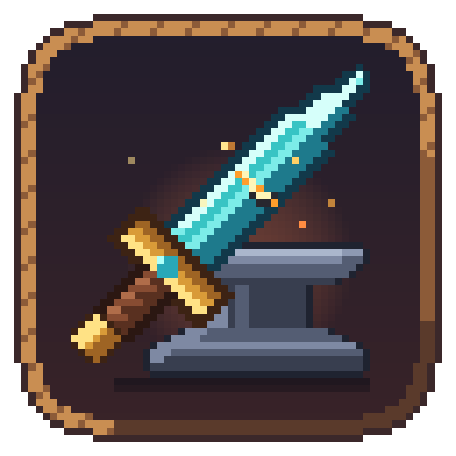

# Keep My Sword



Items stay in your inventory when durability runs out instead of disappearing. Broken tools, weapons, and armor remain the real item in-place — completely unusable until repaired, with zero save-file pollution and zero dependencies.

## How it works

- **In-place broken state**: When a damageable item reaches 0 durability, destruction is prevented and durability clamps at 0. Break sound, item particles, and an optional actionbar notice play once when it breaks.
- **Disabled until repaired**: Broken items deal bare-hand damage, mine at hand speed without tool drops, provide zero attributes or armor, skip passive ticks and combat/protection/movement enchantments, cannot be right-clicked as tools or weapons, and cannot be consumed as ordinary crafting ingredients.
- **Still lets you open blocks**: Right-clicking an anvil, crafting table, grindstone, chest, or modded repair station while holding a broken item falls back to a bare-hand block interaction.
- **Works natively with every repair system**: Because the broken item stays a real `ItemStack`, anvils, grindstones, crafting repair, Mending (configurable), Enchanting Infuser, Sophisticated Backpacks, and other modded repair mechanics work out of the box.
- **Elytra-safe & mod-friendly**: Vanilla Elytra (which stops gliding at 1 durability) is never interfered with, and `#slashblade:swords`, `#tconstruct:modifiable`, `#tetra:modular_items` are excluded by default (missing mod tags are ignored safely).

## Configuration

Edit in-game via **ModMenu** (Fabric) or the **Mods -> Config** button (Forge / NeoForge) for instant hot-reload, or edit `config/keep_my_sword.toml`:

| Key | Default | Effect |
| --- | --- | --- |
| `allowMendingWhenBroken` | `true` | Allow Mending to repair broken items with XP orbs. |
| `showBreakNotification` | `true` | Show an actionbar message when an item first enters the broken state. |
| `showBrokenOverlay` | `true` | Draw a 5×5 broken-item badge on the bottom-right corner of GUI slots. |
| `excludedItems` | `["#slashblade:swords", "#tconstruct:modifiable", "#tetra:modular_items"]` | Item IDs (`"minecraft:diamond_sword"`) or item tags (`"#modid:tag"`) skipped by Keep My Sword. |

Datapacks can also exclude items via the `#keep_my_sword:excluded` item tag.

## Supported Versions

Zero runtime dependencies (no Fabric API, no library mod required).

| Minecraft | Loaders | Java |
| --- | --- | --- |
| `1.20.1` | Fabric, Forge | 17 |
| `1.21.1` | Fabric, NeoForge | 21 |
| `26.1.2` | Fabric, NeoForge | 25 |
| `26.2` | Fabric, NeoForge | 25 |
| `26.3` | Fabric, NeoForge | 25 |

## Building & Verification

Enable the local `pre-push` verification hook once per clone:

```bash
./scripts/setup-hooks.sh
```

Run the full verification suite (10-target build matrix, property-based invariant tests, packaged-JAR architecture contracts, config screen lifecycle test, and packaged-JAR Minecraft `1.21.1` NeoForge GameTest E2E). Pass `--container` (or omit JDK 17/21/25 on the host) to run inside `Dockerfile.verify`:

```bash
./scripts/verify.sh [--container]
```

## Download

- [Modrinth](https://modrinth.com/mod/keep-my-sword)
- [GitHub Releases](https://github.com/rinchan-hoshino/keep-my-sword/releases)
