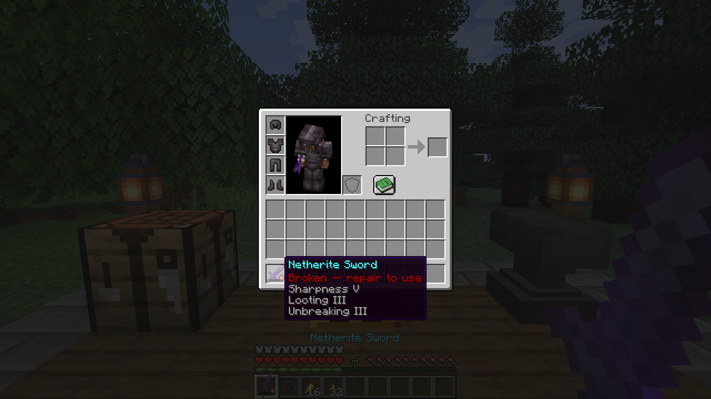
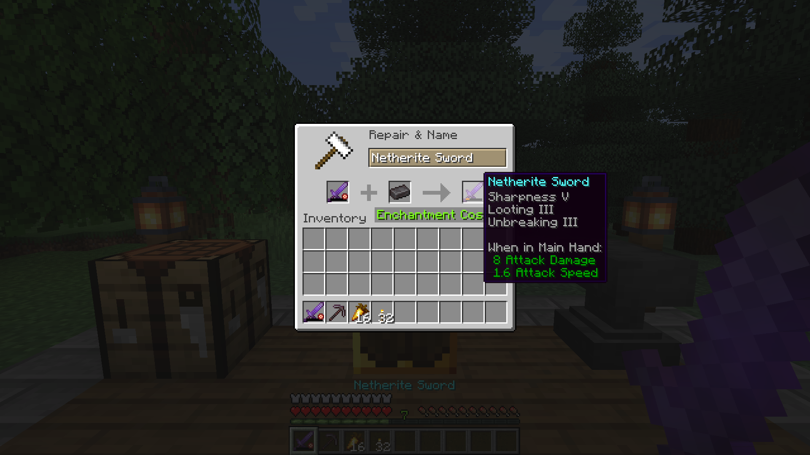

# Keep My Sword

  

**Gear stays in your inventory at 0 durability instead of vanishing when it breaks.**

**Keep My Sword** prevents broken tools, weapons, and armor from disappearing. When durability runs out, the item remains in its slot in a broken, unusable state until you repair it — working out of the box with anvils, Mending, and modded repair stations.

## How It Works

- **Breaks in place**: Reaching `0` durability plays the break sound and particles once, keeps the item in your inventory with a small broken-item corner indicator, and disables its attack damage, mining speed, tool drops, armor stats, passive effects, and enchantments until repaired.
- **Never blocks chests or workstations**: Right-clicking a chest, anvil, crafting table, grindstone, or modded workstation while holding a broken item still opens the block normally, and broken gear won't be accidentally consumed as an ordinary crafting ingredient.
- **Repair anywhere**: Because the broken gear remains the real item, vanilla anvils, grindstones, crafting repair, Mending (toggleable), Enchanting Infuser, Sophisticated Backpacks, and other repair mods work without extra compat patches.
- **Sensible defaults**: Vanilla Elytra keeps its normal `1`-durability broken-wing behavior, and modular gear from *SlashBlade*, *Tinkers' Construct*, and *Tetra* is skipped automatically.

## Configuration

Toggle options in-game via **Mod Menu** (Fabric) or **Mods → Config** (Forge / NeoForge), or edit `config/keep_my_sword.toml`:

| Key | Default | Description |
| --- | --- | --- |
| `allowMendingWhenBroken` | `true` | Let Mending repair broken items when collecting XP orbs. |
| `showBreakNotification` | `true` | Show an actionbar alert when an item breaks. |
| `showBrokenOverlay` | `true` | Show a small broken indicator on the corner of broken items in GUIs. |
| `excludedItems` | `["#slashblade:swords", "#tconstruct:modifiable", "#tetra:modular_items"]` | Item IDs (`"minecraft:diamond_sword"`) or item tags (`"#modid:tag"`) ignored by Keep My Sword. |

Modpacks and datapacks can also exclude items with the `#keep_my_sword:excluded` item tag.
